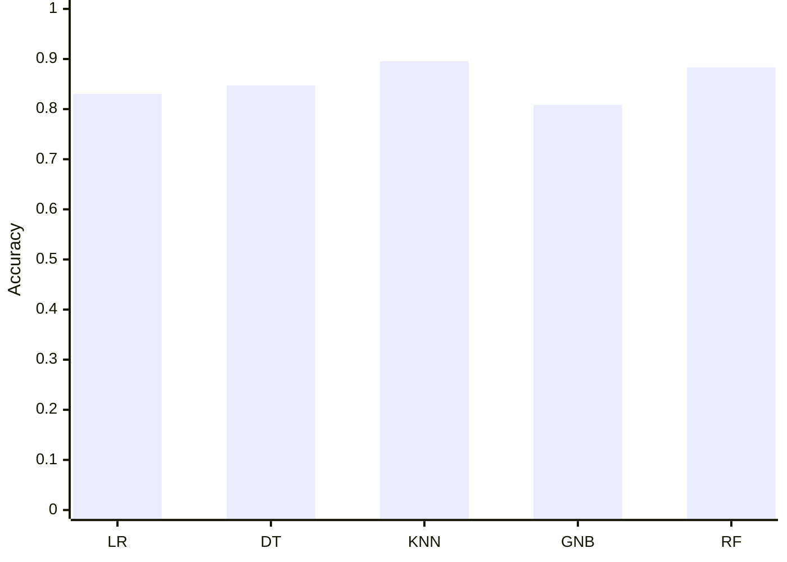
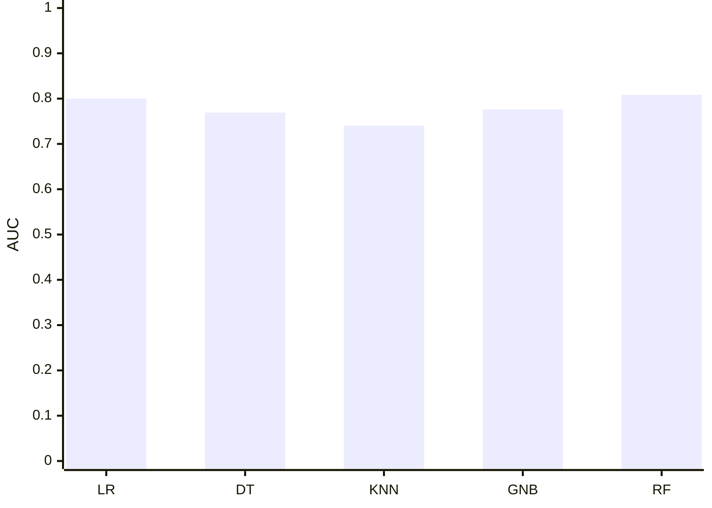
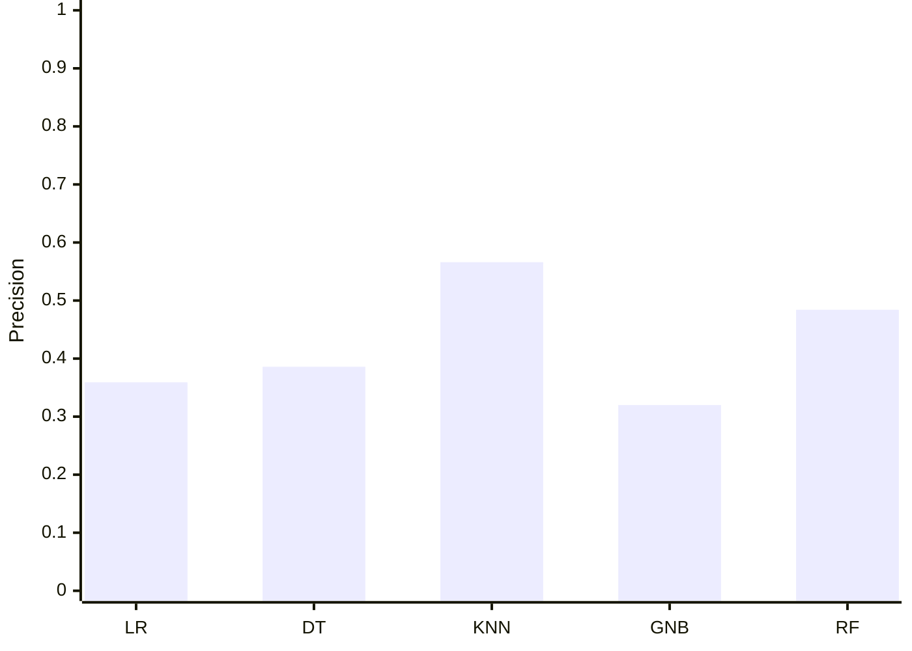
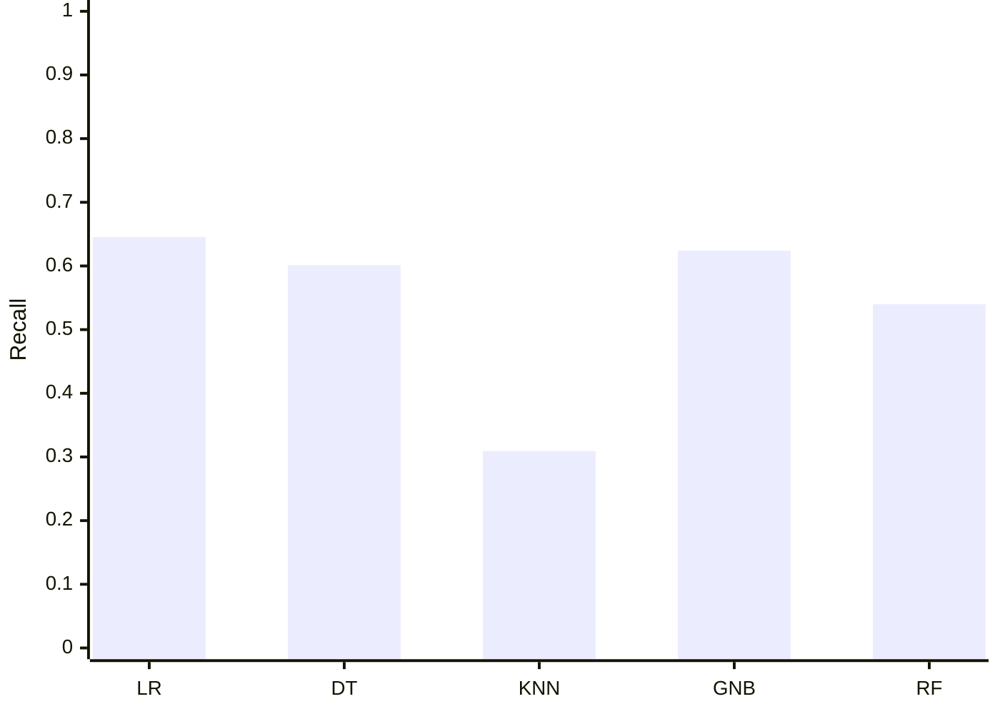
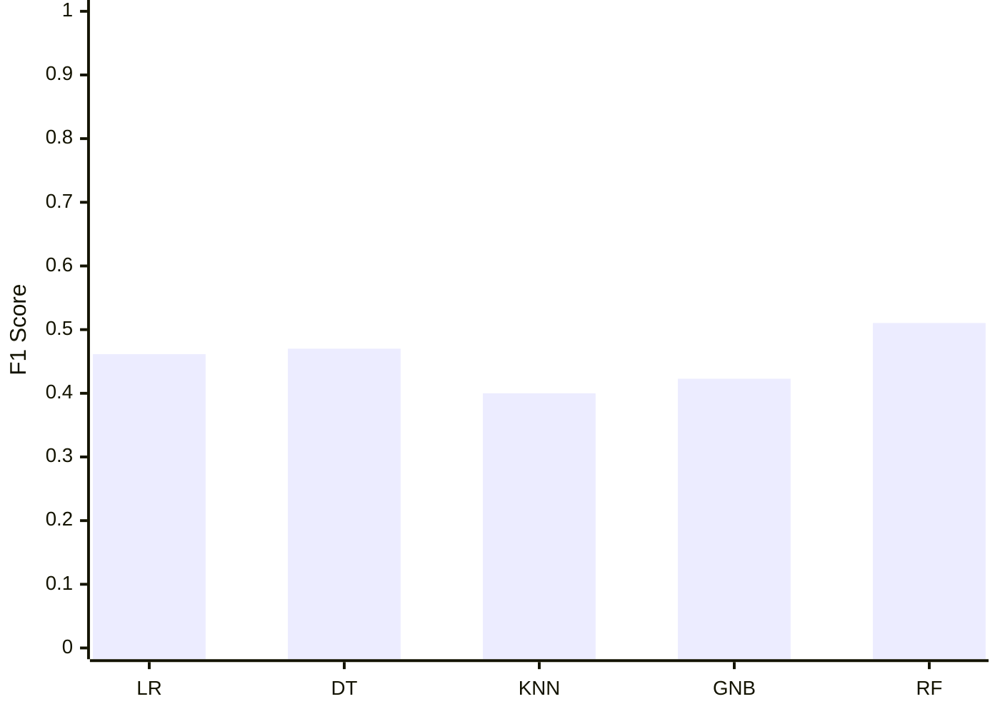
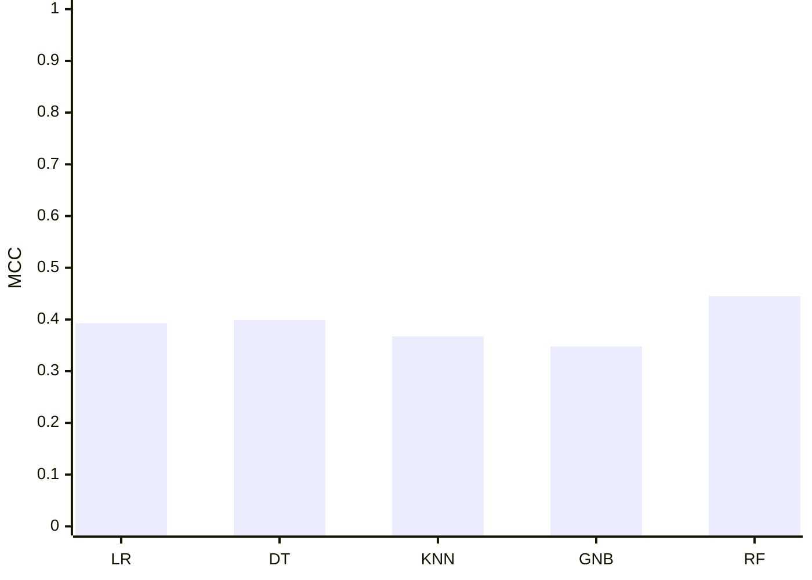

# Bank Marketing Subscription Prediction 2026CT05006 – Machine Learning Assignment 2

## 1. Problem Statement

The objective of this project is to develop and compare five supervised machine learning classification algorithms to predict whether a bank customer will subscribe to a term deposit following a marketing campaign.

The project uses the Bank Marketing dataset from the UCI Machine Learning Repository.

The target variable is `y`:
- `0` – Customer did not subscribe.
- `1` – Customer subscribed.

The goal is to identify the most suitable classification model by comparing multiple evaluation metrics.

## 2. Dataset Description

**Dataset:** Bank Marketing – `bank-additional-full.csv`

**Source:** [UCI Machine Learning Repository – Bank Marketing](https://archive.ics.uci.edu/dataset/222/bank+marketing)

The dataset contains information related to direct marketing campaigns conducted by a Portuguese banking institution through telephone calls.

| Property | Description |
|---|---|
| Original records | 41,188 |
| Original input features | 20 |
| Target variable | `y` |
| Classification type | Binary classification |
| Target classes | Yes / No |
| Records after duplicate removal | 41,176 |
| Features used in modelling | 19 |

The original dataset contains both numerical and categorical features.

### Target Distribution After Data Cleaning

| Class | Records | Percentage |
|---|---:|---:|
| No (0) | 36,537 | 88.74% |
| Yes (1) | 4,639 | 11.26% |
| Total | 41,176 | 100% |

The dataset is imbalanced, with significantly more non-subscribers than subscribers.

## 3. Data Preprocessing

The following preprocessing steps were performed:

1. **Missing value analysis:** Checked all columns for missing values. No conventional null values were found.
2. **Duplicate removal:** Identified and removed 12 duplicate records.
3. **Categorical features:** Applied OneHotEncoder to convert categorical variables into numerical representations.
4. **Numerical features:** Applied StandardScaler to standardize numerical variables.
5. **Unknown categories:** Retained explicit `unknown` values as categorical values.
6. **Feature selection:** Excluded the `duration` feature because call duration is known only after the call has ended and is not available for realistic pre-call prediction.
7. **Target encoding:** Encoded `no` as 0 and `yes` as 1.
8. **Train-test split:** Divided the dataset into 80% training and 20% testing data.
9. **Stratified sampling:** Used stratification to maintain the target class distribution.
10. **Reproducibility:** Used random_state=42.
11. **Data leakage prevention:** Fitted preprocessing transformations only on the training data through Scikit-learn pipelines.

### Train-Test Split

| Dataset | Records | Features |
|---|---:|---:|
| Training | 32,940 | 19 |
| Testing | 8,236 | 19 |

## 4. Machine Learning Models Implemented

The following five classification algorithms were implemented using Scikit-learn:

### 4.1 Logistic Regression
A supervised classification algorithm used to estimate the probability of a customer subscribing to a term deposit.

Configuration:
- Maximum iterations: 1000
- Class weight: Balanced
- Random state: 42

### 4.2 Decision Tree Classifier
A tree-based classification algorithm that makes predictions by splitting data based on feature values.

Configuration:
- Maximum depth: 10
- Class weight: Balanced
- Random state: 42

### 4.3 K-Nearest Neighbors (KNN)
A distance-based classification algorithm that predicts a class based on the majority class among its nearest neighbors.

Configuration:
- Number of neighbors: 5

### 4.4 Gaussian Naive Bayes
A probabilistic classification algorithm based on Bayes' theorem, assuming continuous features follow a Gaussian distribution.

Configuration:
- Classifier: GaussianNB

### 4.5 Random Forest Classifier
An ensemble learning algorithm that combines multiple decision trees to improve classification performance.

Configuration:
- Number of estimators: 100
- Maximum depth: 15
- Class weight: Balanced
- Random state: 42
- Number of jobs: -1

## 5. Model Performance Comparison

All five models were evaluated using the same test dataset and six classification metrics.

| ML Model | Accuracy | AUC | Precision | Recall | F1 Score | MCC |
|---|---:|---:|---:|---:|---:|---:|
| Logistic Regression | 0.8303 | 0.8002 | 0.3591 | 0.6455 | 0.4615 | 0.3928 |
| Decision Tree | 0.8473 | 0.7693 | 0.3859 | 0.6013 | 0.4701 | 0.3987 |
| KNN | 0.8955 | 0.7404 | 0.5661 | 0.3093 | 0.4000 | 0.3673 |
| Gaussian Naive Bayes | 0.8082 | 0.7761 | 0.3199 | 0.6239 | 0.4229 | 0.3478 |
| Random Forest | 0.8833 | 0.8085 | 0.4841 | 0.5399 | 0.5104 | 0.4453 |


## 6. Model Performance Visualization

The following charts compare the performance of all five classification models across six evaluation metrics.

### Accuracy Comparison



### AUC Comparison



### Precision Comparison



### Recall Comparison



### F1 Score Comparison



### MCC Comparison



**Observation:** Random Forest achieved the highest AUC (0.8085), F1 Score (0.5104), and MCC (0.4453). KNN achieved the highest accuracy (0.8955) and precision (0.5661), while Logistic Regression achieved the highest recall (0.6455).

## 7. Observations on Model Performance

| ML Model | Observation |
|---|---|
| Logistic Regression | Achieved 83.03% accuracy and the highest recall of 64.55%. It identified a relatively high proportion of actual subscribers but had comparatively low precision. |
| Decision Tree | Achieved 84.73% accuracy and an F1-score of 0.4701. It provided a reasonable balance between precision and recall. |
| KNN | Achieved the highest accuracy of 89.55% and precision of 56.61%. However, its recall was only 30.93%, meaning it missed many actual subscribers. |
| Gaussian Naive Bayes | Achieved 80.82% accuracy and 62.39% recall. It identified a reasonable proportion of subscribers but had relatively low precision. |
| Random Forest | Achieved the highest AUC (0.8085), F1-score (0.5104) and MCC (0.4453), demonstrating the best overall balance among the five models. |

## 8. Overall Winner

**Random Forest was selected as the best overall model.**

Although KNN achieved the highest accuracy (89.55%), it had a relatively low recall of 30.93%.

Random Forest achieved:
- Accuracy: 88.33%
- AUC: 0.8085
- Precision: 0.4841
- Recall: 0.5399
- F1 Score: 0.5104
- MCC: 0.4453

Random Forest was selected because it achieved the highest F1-score, MCC and AUC among the five evaluated algorithms.

The results demonstrate that accuracy alone is not sufficient for evaluating an imbalanced classification problem. Multiple evaluation metrics are necessary to understand the performance of classification algorithms.

## 9. Repository Structure

```text
2026CT05006/
│
├── 2026CCT05006.ipynb
├── README.md
├── requirements.txt
├── test_data.csv
│
└── models/
    ├── decision_tree.pkl
    ├── gaussian_naive_bayes.pkl
    ├── knn.pkl
    ├── logistic_regression.pkl
    └── random_forest.pkl
```

## 10. Execution Instructions

### Prerequisites

- Python 3.x
- Jupyter Notebook or Google Colab

### Install Dependencies

```bash
pip install -r requirements.txt
```

### Run the Project

1. Clone or download this GitHub repository.
2. Open `2026CCT05006.ipynb` using Google Colab or Jupyter Notebook.
3. Download the original `bank-additional-full.csv` dataset from the UCI repository.
4. Upload the dataset when prompted by the notebook.
5. Execute the notebook cells sequentially to perform preprocessing, model training, evaluation and visualization.

The saved model pipelines are available in the `models/` directory.

## 11. GitHub Repository

**Repository:** https://github.com/2026ct05006-ux/2026CT05006

## 12. Conclusion

This project implemented and compared five supervised machine learning classification algorithms for predicting bank term deposit subscriptions.

The models were evaluated using six performance metrics on a stratified test dataset.

Based on the experimental results, Random Forest demonstrated the strongest overall performance, particularly in terms of AUC, F1-score and MCC.

The experiment highlights the importance of data preprocessing, handling class imbalance and evaluating classification models using multiple metrics rather than relying solely on accuracy.
